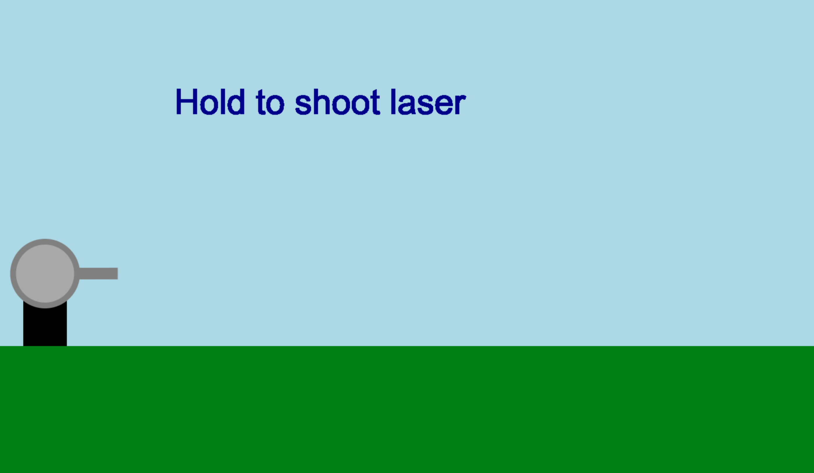
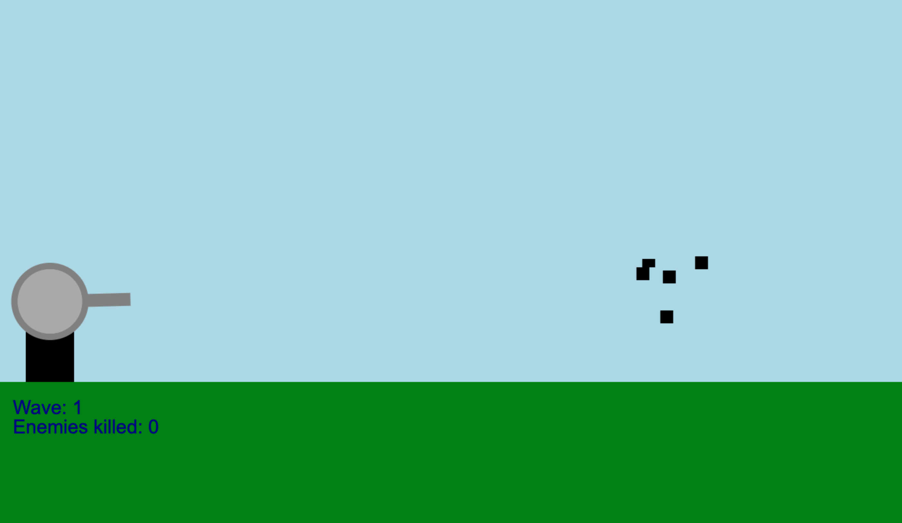

# angry_lasers
A simple wave-by-wave game about using lasers to destroy the enemies in a protect-the-base manner.
Each wave enemies spawn and your goal is to kill them. The game ends when the enemies reach our base/the turret.
**NOTE**: 
This game was built for desktop devices only, testing has not been conducted for mobile devices at time of publishing
Also to anyone reading my code :uhm..... good luck with that, because its pretty messy. I had no idea what I was doing and midway through realised it went horribly bad so yeahh.. Sorry and have fun :D




## how to use it
Pretty simple controls.
Press your left-click button to charge up the laser.
Drag and move around your cursor to the enemy you wish to kill and release.

## how it works
Okay, up front, 
*disclaimer and a note to any moderator rating my project: building this was pretty tough for me. I have 0 experience both in HackClub and coding in general, so please forgive me for my mistake which I might've made.*
Getting into it, 
Yes, AI was used in building this project specifically :
the damage system
the turret moving system
the final lose condition.
I used gemini in the browser and tried to minimise the use of AI, mostly using documentation from MDN docs and GeeksForGeeks.
It was built using the canvas api, the remaining features are so basic I dont even know whether or not to mention them. 
## building
```
npm install
node build.mjs
```